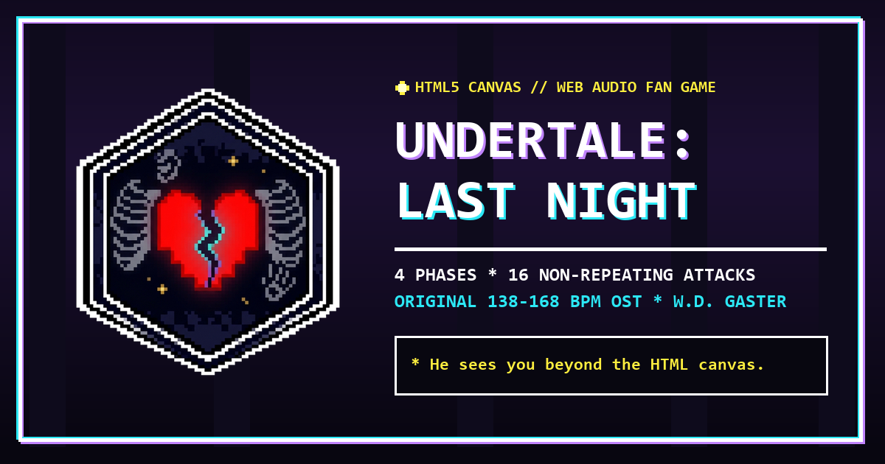

<p align="center">
  
</p>

# UNDERTALE: LAST NIGHT

A playable browser-based **Undertale** fan game built with HTML5 Canvas, zero external dependencies, pure ES Modules, and procedural Web Audio soundtrack & sound effects.

**[Play Online on GitHub Pages](https://efeartn.github.io/UndertaleLastNight/)**

---

## Features

- **Custom 1:1 Pixel-Matrix Art & Dynamic Battle Visuals**
  - Handcrafted offscreen pixel-matrix sprites (`sprites.js`) with **phase-tinted Sans rim lighting**, **glowing chest slash embers**, and a **12-segment multi-layer eye flame ribbon**; **6 SOUL Aura Skins**; **W.D. Gaster Unbound** featuring dedicated `GASTER_UNBOUND_CLOAK_GRID` + `GASTER_UNBOUND_SKULL_GRID` matrices, lightning hand tethers, and orbiting arcane runes; beat-synced **Phase 1–5 Battle Backdrops** (Cathedral stained-glass windows, Crimson storm wind streaks & embers, branching Void sky fissures & horizon crystals, Parallax Perspective Void Floor Grid); neon-core bones, spiked bone wheels, Blaster muzzle shockwaves, chamfered beveled battle buttons, **Hitstop**, **SOUL Afterimage Trails**, **Slash Arcs**, and **Chromatic Aberration**.
- **5 Playable SOUL Modes + SOUL Dash & Style Rank**
  - **Red SOUL**: Classic free directional & 360° analog movement.
  - **Blue SOUL**: 4-directional gravity slams (`up`, `down`, `left`, `right`) and moving platforming.
  - **Green SOUL**: Center-locked 4-way shield (with mobile diagonal/analog dominant-axis fallback) deflecting spears (including healing green spears).
  - **Yellow SOUL**: Justice shooter — tap `Z` / `Enter` for rapid bolts, or **Hold `Z` (`>= 0.38s`)** to fire a piercing **Charged Big Shot** that breaks armored blocks & vaporizes small bones.
  - **Purple SOUL**: Glide horizontally across **3 glowing violet web rails** using `Up` / `Down` to dodge Web Matrix & Arcane Rune patterns.
  - **SOUL Dash & Close-Call Slow-Mo**: Press **`X` / `Shift`** during attacks for an i-frame burst (`0.95s` cooldown); close grazes during Dash trigger micro-slow-mo (`CLOSE CALL!`), +TP, and elevate your **Live Style Rank (`C -> B -> A -> S -> SS`)**.
- **10-Track Original OST Synth Engine & In-Game Sound Test Jukebox**
  - Upgraded Web Audio synthesizer (`audio.js`) with **Distorted Lead Guitar Overdrive** (`WaveShaperNode`), **Stereo Echo Delay** (`DelayNode`), **Void Choir Pads**, live **FFT Audio Visualizer**, and dynamic tempo boost:
    `MIDNIGHT OVERTURE` (Title, 104 BPM) · `TWILIGHT JUDGMENT HALL` (96 BPM) · `ECHOES OF WATERFALL` (92 BPM) · `JUDGMENT OVERDRIVE` (Phase 1, 138 BPM) · `CRIMSON VELOCITY` (Phase 2, 150 BPM) · `SHATTERED DAWN` (Phase 3, 158 BPM) · `VOID ANOMALY // 666` (Phase 4, 168 BPM) · `DARKER YET DARKER // UNBOUND` (Phase 5, 176 BPM) · `FIRST LIGHT OF DAWN` (Victory, 116 BPM) · `SHATTERED DETERMINATION` (Game Over, 74 BPM).
- **24 Non-Repeating Attacks Across 5 Phases, 3-Tier Hardcore Difficulty & 2-Page Practice Select**
  - Expanded from 20 to **24 fair 0-hit-clearable attacks** (`#9 Crimson Sawmill`, `#12 Shatter Prism`, `#17 Abyssal Clockwork`, and finale `#24 LAST NIGHT APOCALYPSE`), selectable in a **2-page Attack Practice Select (`12` cards/page)** and **24-Attack Boss Rush**.
  - **3-Tier Difficulty System** (`Normal | Hard | Nightmare`, defaulting to **Hard** and persisted in `localStorage`) scaling pattern density, charge speeds, projectiles, damage, KARMA, and OST tempo — plus **Low-HP Pulse**, live **Difficulty & SOUL Mode HUD badges**, Gaster Box-Grip Hands, Dynamic Tilted Battle Box, Phase 3+ Button Scrambler, Meta HUD Callouts, and Dynamic Tab Titles.
- **Expanded Overworld: Echo Sanctum, Void Vault & New Relics**
  - Walk **West** from the Twilight Antechamber to discover **Echo Flower Sanctum** (3 glowing Echo Flowers, **Relic Forge & SOUL Skin Shrine** selling `Empty Gun`, `Void Blade`, `Void Cloak`, `Heart Locket+` + skins), and enter the mysterious grey door to **Entry Seventeen // Void Vault** to claim the **Void Key** unlocking Story Phase 5!
- **Trophies (14), Challenge Modifiers & Endless Leaderboard**
  - Unlock 14 persistent trophies (including **Hardcore Survivor** and **Nightmare Sovereign**) in **🏆 Trophies**, customize **6 SOUL Skins**, toggle **Challenge Modifiers** (`Ironman 1-HP`, `Hyper Speed 1.35x`, `Inverted Gravity`, `Mirror Horizon`), and climb the **Local Top-5 Endless Leaderboard** in **⚡ Mods**.
- **Full Mobile Handheld Edition: Game Boy Portrait & Switch Landscape Grips**
  - **Portrait (`<= 780px`)**: **Nintendo Game Boy Chassis** with charcoal screen bezel & glowing red power LED, sculpted slide-touch **Precision Cross D-Pad**, staggered circular `B`/`A` domes, tilted `SELECT`/`START` rubber pills, and speaker grille.
  - **Landscape (`<= 540px` height)**: **Full-Height 3-Column Switch Handheld** with rounded left & right Joy-Con grips framing a full-height 4:3 battlefield, defaulting to the sculpted slide-touch **Precision Cross D-Pad** with a 1-tap toggle to a **Full-Grip Floating Dynamic Thumbstick** featuring `±26°` cardinal snap and pointer capture across all buttons.

---

## Controls

| Action | Key / Input |
| :--- | :--- |
| **Move / Switch Web Rail / Shield** | `Arrow Keys`, `WASD`, Precision Cross D-Pad, or Floating Dynamic Thumbstick |
| **Confirm / Shoot / Charge Shot** | `Z` / `Enter` (Hold in Yellow SOUL for Big Shot) or `A` / `START` Touch Button |
| **SOUL Dash (i-Frames) / Cancel** | `X` / `Shift` or `B` Touch Button |
| **Field Menu / Toggle Practice Speed** | `C` / `Esc` or `SELECT` / `C MENU` Touch Button |
| **Practice Select Page** | `Q` / `E` or `PageUp` / `PageDown` |
| **Mute Audio** | `M` |

---

## Run Locally

Because the game uses native ES Modules (`<script type="module">`), serve the folder with any static HTTP server:

```bash
python -m http.server 8085
```

Then open [http://localhost:8085/](http://localhost:8085/) in your browser.
